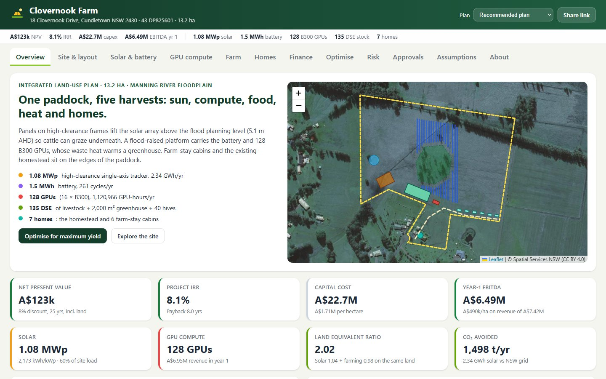
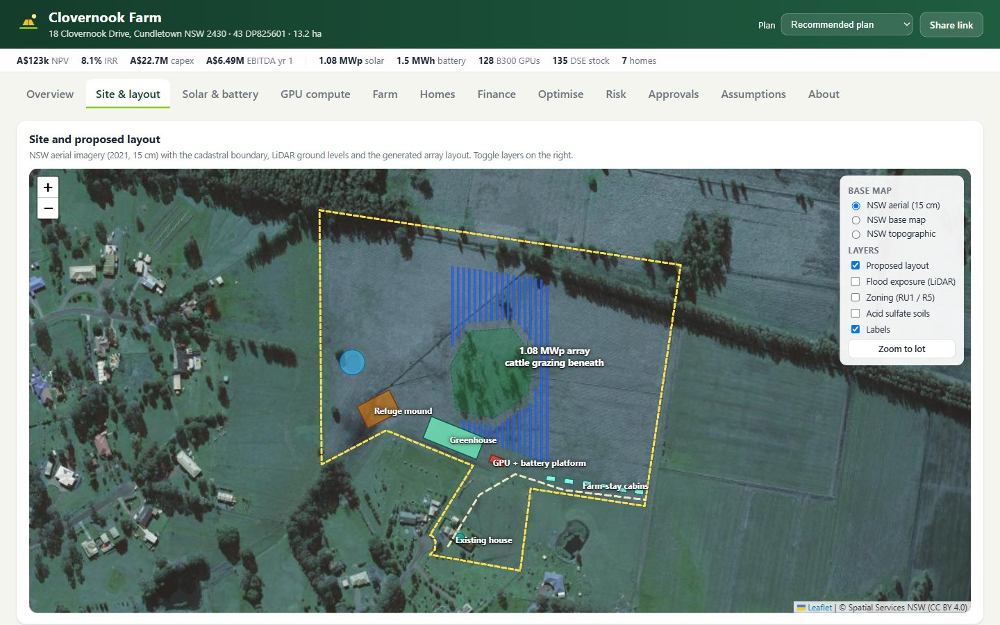
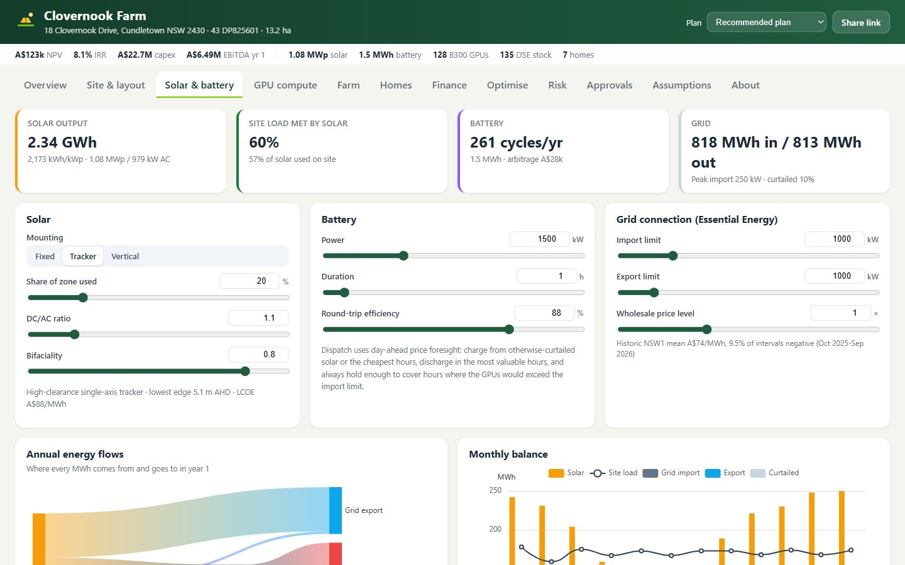
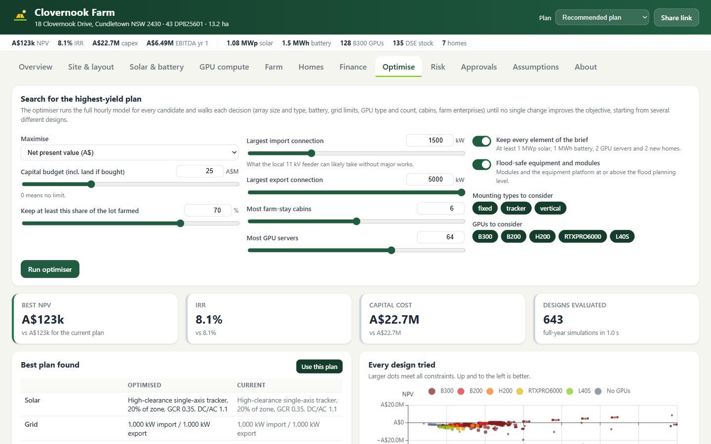

# Clovernook Farm

**An open planning platform for turning 18 Clovernook Drive, Cundletown NSW into a layered farm: agrivoltaic solar over grazing, a battery, a GPU compute platform, a heat-recovery greenhouse and rental homes, sized for the highest return the site supports.**

**Live:** https://peterxing.github.io/clovernook-farm/



## What it does

The site is Lot 43 DP825601: 13.2 ha (32.7 acres) of flat paddock on the Manning River floodplain near Taree, with a 4-bedroom homestead on a small rise. The platform models every hour of a typical year (8,760 hours) and 25 years of cash flow for any combination of:

| Layer | What's modelled |
|---|---|
| **Solar** | Elevated fixed tilt, high-clearance single-axis trackers or vertical bifacial fences, laid out row by row inside the real cadastral boundary. Bifacial gain, row shading/backtracking, temperature, clipping. |
| **Battery** | Day-ahead price-aware dispatch on the last 12 months of NSW1 prices: stores otherwise-curtailed solar, shifts energy to the evening peak, keeps a reserve so the GPUs never exceed the grid import limit, never exports at negative prices. |
| **GPU compute** | B300, B200, H200, RTX PRO 6000 or L40S servers with temperature-dependent PUE, utilisation, interruptible jobs on cheap energy, yearly price decline and hardware refreshes. |
| **Farm** | Sheep, cattle or hens under the panels (pasture shading effect), grazing or hay on open paddock, beehives, and a greenhouse heated by GPU waste heat. |
| **Homes** | Lease the homestead, add a granny flat and farm-stay cabins on flood-raised floors. |
| **Money** | Capex by item, opex, escalation, debt, NPV/IRR/payback, LCOE, land purchase and resale. |

Then it **optimises**: a multi-start coordinate-descent search over 20 decisions (array type, size, ground cover, tilt, DC/AC ratio, import/export limits, battery power and duration, GPU model and count, cabins, granny flat, farm enterprises, greenhouse, hives, and the humanoid robot fleet, its arrival year and buy-or-lease), testing several hundred full-year designs a second in a Web Worker, under a budget, grid limits, a minimum farmed share and flood-safety rules.

## Updated every day

The platform refreshes itself each morning, Sydney time:

1. **Live feeds (GitHub Actions, ~3 am):** AEMO NSW1 prices roll forward to the latest 365 days; RBA exchange rate; Vast.ai GPU marketplace asks (B300, B200, H200, RTX PRO 6000, L40S); InfoLink TOPCon module prices; ABARES weekly cattle and lamb indicators; the FAO Food Price Index; Ecovantage's LGC close; Unitree and 1X humanoid list prices. `scripts/update-market.ts` writes `src/data/market.json`, adds a day to `market-history.json`, **re-runs the optimiser** and saves the new recommended plan to `recommended.json`, then the site redeploys.
2. **Research (Scout automation, ~7:30 am):** reviews news and price trackers for what has no API (humanoid capability milestones and prices, solar and battery build costs, GPU server prices and reserved rates, livestock and farm margins) and updates `src/data/market-curated.json` with sources, then re-optimises and pushes.

Each price starts from a researched level and moves with its live indicator relative to the day it was researched, so a noisy feed can shift the model but never replace it. The **Markets** tab shows every indicator, its trend and which assumptions it set today.

## Humanoid robots

The **Robots** tab models general-purpose humanoids doing the site's work: cabin turnover, greenhouse harvesting, data-centre remote hands, solar checks, livestock and maintenance. Each task has a capability-readiness forecast (an S-curve revised by the daily research) and the robot price follows a forecast decline anchored to live list prices (Unitree H2 at US$29,900 today). Robots only count as savings where they replace labour the model already pays for; owner time freed is shown separately. The optimiser decides whether, when and how many to bring in.



## What the site data says

Pulled from NSW government services when the data is built (`npm run data`):

- **Floodplain.** The 5 m LiDAR DEM puts the paddock at 1.0-2.2 m AHD (median 1.42 m). Design floods at Cundletown from the [Manning River Floodplain Risk Management Study and Plan](https://data.nsw.gov.au/data/dataset/fdp-reports-manning-river-frms-p) (MidCoast Council, 2020): 20% AEP 2.0 m, 5% 3.1 m, 1% 4.1 m, PMF 7.3 m AHD; the 2100 defined flood event is 4.6 m, so the flood planning level is about **5.1 m AHD**. The plan puts modules, the equipment platform, new floors and a livestock refuge mound at or above it, on piles rather than fill to keep floodplain storage.
- **Zoning.** 91.8% RU1 Primary Production (40 ha minimum lot size), 8.2% R5 Large Lot Residential (the house block), Greater Taree LEP 2010.
- **Overlays.** Acid sulfate soils class 2a/2b over ~95% of the lot, bush fire prone grassland (category 3), Koala Management Area, Coastal Environment Area, and Taree Airport 2.3 km south (glint and glare).

## Headline result

The recommended plan is re-optimised every day with every element of the brief required. On 26 October 2026 it was a 1.54 MWp high-clearance tracker array with free-range hens underneath and cattle on the open paddock, a 2 MW / 2 MWh battery, 16 × B300 servers (128 GPUs) on a flood-raised platform, a 2,000 m² greenhouse heated by their waste heat, 40 hives, the leased homestead, six farm-stay cabins and one leased humanoid robot from 2028.

- Capex about **A$24.4M** including the land; year-1 EBITDA about **A$6.7M**; NPV about **A$2.3M** at 8% (IRR ~9.3%).
- GPU compute carries most of the value and most of the risk: rental prices and their rate of decline dominate the Monte Carlo.
- Exporting solar into the NSW midday market doesn't pay at elevated-structure costs, so the array is sized to feed the site.

Today's numbers are on the live site; change any assumption and they update instantly.



## Run it locally

```bash
npm install
npm run dev        # http://localhost:5173
npm test           # engine, optimiser, risk and share-link tests
npm run build      # static site in dist/
npm run data       # rebuild src/data from the public sources (cached in scripts/.cache)
npm run market     # refresh live market feeds and re-optimise the recommended plan (add -- --offline to skip fetching)
```

Everything runs client-side; there is no server. Plans are shareable: the link encodes every change you make.

## How it's built

- `src/engine/` – pure TypeScript model: `solar.ts` (sun position, transposition, bifacial, shading, flood curve), `layout.ts` (row layout in the real lot), `dispatch.ts` (hourly energy balance and battery), `landuse.ts` (farm and homes), `robots.ts` (humanoid readiness, prices and labour substitution), `market.ts` (applies live and researched market data), `model.ts` (capex, cash flow, metrics), `optimize.ts`, `risk.ts` (tornado, Monte Carlo, NPV contributions), `params.ts` (every assumption with its source and range).
- `src/ui/` – React + ECharts + Leaflet front end, heavy jobs in a Web Worker.
- `scripts/build-data.mjs` – fetches the cadastre, zoning, overlays, LiDAR and PVGIS weather and writes compact JSON.
- `scripts/update-market.ts` – the daily market refresh and re-optimisation.
- GitHub Actions runs the tests and deploys to GitHub Pages on every push to `main`, and refreshes the market data every day.



## Data sources and licences

- Cadastre, address, 5 m LiDAR DEM, aerial imagery and base maps: © Spatial Services NSW (CC BY 4.0).
- Zoning, lot size, height, acid sulfate soils, bush fire prone land: NSW Department of Planning Planning Portal spatial data (CC BY 4.0).
- Design flood levels: Manning River Floodplain Risk Management Study and Plan, BMT for MidCoast Council, 2020 (CC BY 4.0).
- Weather: PVGIS 5.3 TMY (PVGIS-ERA5), © European Commission JRC; beam/diffuse split calibrated to NASA POWER climatology.
- Electricity prices: AEMO aggregated price and demand data, NSW1, rolling 365 days (used with acknowledgement under AEMO's copyright permissions).
- Daily market feeds: Reserve Bank of Australia exchange rates; Vast.ai marketplace offers; InfoLink spot prices; ABARES weekly commodity price update; FAO Food Price Index; Ecovantage certificate market update; Unitree and 1X list prices.
- Costs and market prices: cited per assumption in the app (GPU rental indices, server quotes, battery and solar build costs, Essential Energy tariffs, LGC prices, NSW DPI gross margins, local rental data, humanoid robot prices).

## Disclaimer

A concept study for discussion. It is not financial, engineering, planning or legal advice, and it isn't affiliated with the owner, vendor or selling agent of the property. Flood levels, layout features and planning pathways must be confirmed with MidCoast Council, Essential Energy and qualified consultants.

Code is MIT licensed; data keeps its source licence.
